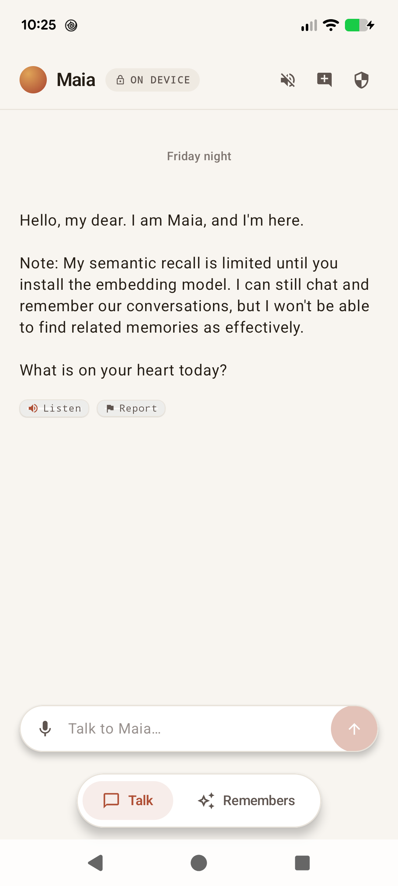
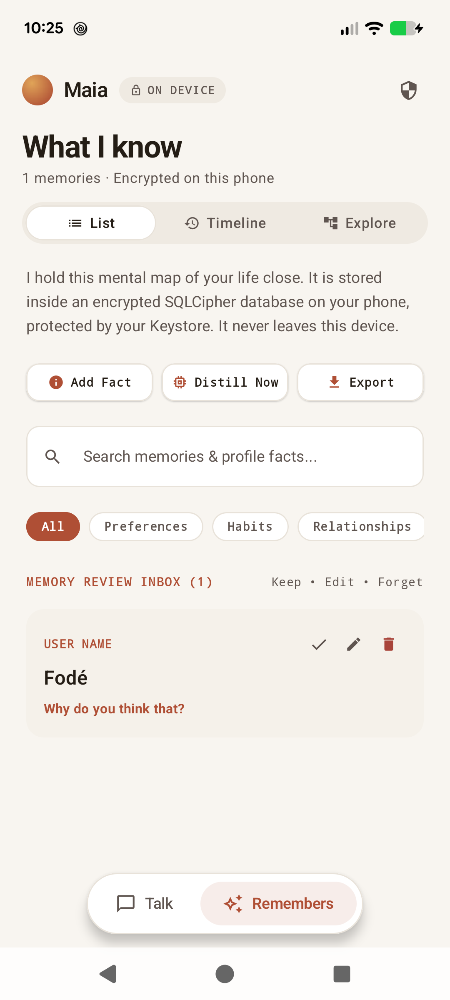
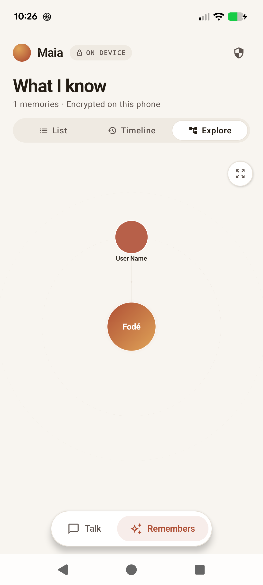
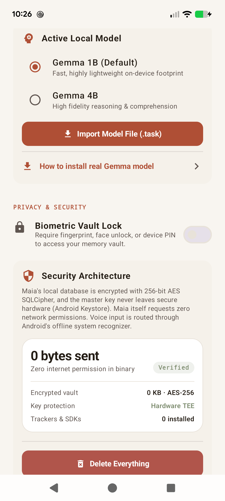

<p align="center">
  
</p>

<h1 align="center">Maia — Privacy-First On-Device AI Companion</h1>

<p align="center">
  <a href="LICENSE"></a>
  <a href="app/src/test/java/com/example/PermissionAuditTest.kt"></a>
  <a href="https://github.com/sponsors/botmechanic"></a>
  <a href="https://heymaia.app"></a>
</p>

<p align="center">
  <strong>"She remembers. She protects. She's yours."</strong>
</p>

Maia is a warm, protective, mother-archetype personal AI companion app for Android. Designed to stay entirely offline, she chats with you, remembers your life, and guarantees that your data never leaves your phone.

| Talk · On-Device | What I Know | Mind Map | 0 Bytes Sent |
| :---: | :---: | :---: | :---: |
|  |  |  |  |

---

## 🎨 Design Philosophy & Tone

Maia blends **Warm Architectural Precision** with **Apple-like Minimalism**—a calm, uncluttered private space that feels like archival stationery and candlelight rather than a clinical productivity tool (see [`docs/design/DESIGN_PRINCIPLES.md`](docs/design/DESIGN_PRINCIPLES.md)).

*   **Warm Hearth Palette:** Morning Hearth (`#F8F5F0` canvas, `#FFFFFF` `1dp`-hairline cards) and Evening Hearth (`#171310` charcoal) with automatic system theme following.
*   **Floating Minimalist Chrome:** Unified top bar (`MaiaOrb` + quiet `ON DEVICE` pill + privacy shield), floating pill chat composer, and a suspended floating pill bottom navigation bar (`Talk` · `Remembers`).
*   **Inspectable Memory:** Switch seamlessly between **List** (with *Keep / Edit / Forget* review actions), **Timeline**, and **Explore** (interactive 2D Mind Map), and tap *"Why do you think that?"* on any fact to see its exact source conversation turn.

---

## 🧠 Memory Pipeline & RAG Architecture

Maia utilizes a tri-store RAG (Retrieval-Augmented Generation) memory pipeline to carry your life in her mind entirely offline:

```
                  ┌──────────────────────────────────────────────┐
                  │                 User Message                 │
                  └──────────────────────┬───────────────────────┘
                                         │
                                         ▼
                               [Episodic Memory]
                         Logs raw message into SQLite
                                         │
                                         ▼
                             [MediaPipe Text Embedder]
                         Generates semantic vector array
                                         │
                                         ▼
                               [Semantic Memory]
                       Saves normalized Float list in DB
                                         │
                                         ▼
                            [Cosine Similarity Search]
                        Queries top-k matching past events
                                         │
                                         ▼
                            [Profile Memory Fact Base]
                       Extracts core facts (e.g., sister)
                                         │
                                         ▼
                  ┌──────────────────────────────────────────────┐
                  │              Assembled Context               │
                  │  - Core active profile facts                 │
                  │  - Top-k semantically matched past memories  │
                  │  - Last 10 preceding chat dialogue turns     │
                  │  - Custom loving, motherly system prompt     │
                  └──────────────────────┬───────────────────────┘
                                         │
                                         ▼
                            [On-Device Gemma LLM Run]
                      Streams warm response back to the user
                                         │
                           ┌─────────────┴─────────────┐
                           ▼                           ▼
                     (Charging Only)           (Vibration Tick)
                   [Distillation Job]          [Haptic Feedback]
                  Background Worker reviews       Informs thought
                    recent logs & updates          stream complete
                     profile facts table
```

1.  **Episodic Memory:** An append-only, encrypted SQLite/Room log (non-destructive versioned migrations, schema v6) of all raw exchanges and observations.
2.  **Semantic Memory:** Uses Universal Sentence Encoder (USE) Lite via MediaPipe to generate 512-dimensional L2-normalized embeddings, stored as compact little-endian binary `BLOB`s (`VectorCodec`, 2 KB per vector) for fast, low-GC cosine similarity search.
3.  **Profile Memory:** A list of distilled facts (e.g. `Hobby = Guitar`) with provenance links back to source turns, superseded history tracking, and in-app *Keep / Edit / Forget* curator controls.
4.  **Distillation Job:** A periodic background WorkManager job (constrained to charging states) that reviews recent conversation logs, extracts structural details, and updates profile facts.

---

## 🔒 Security & Privacy

*   **No Network Access:** There is **zero** `INTERNET` permission declared in the manifest (enforced by automated unit tests in [`PermissionAuditTest.kt`](app/src/test/java/com/example/PermissionAuditTest.kt)). Maia physically cannot send your data to any external server.
*   **SQLCipher Encryption:** The local Room database is encrypted using 256-bit AES SQLCipher (`4.6.1`, 16 KB page-aligned), with zero plaintext PII in `SharedPreferences`.
*   **Hardware Keystore:** The encryption passphrase is dynamically generated and wrapped inside the Android Keystore (Hardware TEE / StrongBox, verified dynamically via `KeyInfo`), with graceful [`VaultRecoveryScreen`](app/src/main/java/com/example/ui/screens/VaultRecoveryScreen.kt) handling.
*   **Full-App Biometric Lock & Encrypted Exports:** Optional fingerprint / screen-lock gate (`BiometricPrompt`) that verifies enrollment in Settings and automatically re-locks Maia when backgrounded, plus password-protected AES-256-GCM `.maiavault` archive exports.
*   **Deterministic Crisis Safety & Offline Reporting:** Built-in deterministic crisis intervention layer surfaces local support lifelines immediately without relying on LLM generation, paired with a zero-network `mailto:` response reporting action.

---

## 📱 Device Requirements

Because Maia runs entirely on-device with local AI inference, your device needs adequate hardware resources:

### Minimum Requirements (Gemma 3 1B INT4 ~555MB)
- **RAM**: 6GB minimum, 8GB recommended
- **Storage**: 2GB+ free space for models
- **Processor**: Mid-range or better (Snapdragon 700+ series, MediaTek Dimensity 900+, or equivalent)
- **Android Version**: Android 8.0+ (API 26+)
- **MediaPipe**: `tasks-genai` / `tasks-text` **0.10.29+** (required for Gemma 3 signatures)

### Recommended Devices
- **Google Pixel 6a or newer** - Excellent MediaPipe support, 6-8GB RAM
- **Samsung Galaxy A54 5G / S21+** - Good mid-range options with sufficient memory
- **OnePlus Nord 2/3 or flagship models** - Reliable performance for on-device AI
- **Any flagship device from 2021+** - Typically 8GB+ RAM

### Known Limitations
- **Budget devices (4GB RAM or less)**: May experience crashes or OOM errors
- **Wrong model format**: `.bin` / `.tflite` files (or renamed to `.task`) trigger MediaPipe `RET_CHECK` failures looking for `prefill`/`decode` subgraphs
- **Prompt length**: MediaPipe aborts the process if input tokens ≥ `maxTokens`. Maia uses `maxTokens=2048`, reserves space for the reply, truncates oversized RAG prompts, and keeps RAG context blocks small for on-device use.

**Note**: If you encounter model loading issues or crashes, verify you have an official `.task` bundle and MediaPipe 0.10.29+, then check device RAM.

---

## 📦 Downloading & Installing the Gemma Model

Because Maia runs entirely on-device, her cognitive brain requires a physical Gemma model file located on your phone's memory.

### Step 1: Download the Official `.task` Bundle

**Current Recommendation: Gemma 3 1B INT4 (MediaPipe/LiteRT)**

1.  Open **[litert-community/Gemma3-1B-IT](https://huggingface.co/litert-community/Gemma3-1B-IT)** on Hugging Face (accept the license if prompted)
2.  Download **`gemma3-1b-it-int4.task`** (~555MB)
3.  Do **not** use raw `.bin` or `.tflite` weights — MediaPipe needs the bundled tokenizer + `prefill`/`decode` signatures

### Step 2: Load the Model (3 Zero-Network Options)

1. **Google Play Asset Delivery (`:model_pack`, for Play Store builds):** Drop `gemma3-1b-it-int4.task` and `universal_sentence_encoder.tflite` into `model_pack/src/main/assets/models/` before building `:app:bundleRelease` (see [`model_pack/README.md`](model_pack/README.md)). `BundledModelExtractor` automatically stages them into fast internal storage on first launch.
2. **In-App File Picker (No ADB Required):** Open **Settings → Active Local Model → Import Model File (`.task`)** to select a `.task` file from your phone via Android's Storage Access Framework.
3. **ADB Transfer (Developers):**

```bash
# Official LiteRT filename (preferred)
adb push gemma3-1b-it-int4.task /sdcard/Android/data/app.heymaia/files/models/

# Legacy Maia filename also accepted
# adb push gemma3-1b-it-int4.task /sdcard/Android/data/app.heymaia/files/models/gemma-1b-it-cpu-int4.task
```

**Note**: Maia checks both app-private internal storage (`files/models/`, fastest I/O bypassing FUSE) and external app storage, preferring `gemma3-1b-it-int4.task` with fallback to `gemma-1b-it-cpu-int4.task`.

### Step 3: Download & Transfer the Embedding Model (Optional but Recommended)

For full semantic memory recall, Maia needs the Universal Sentence Encoder (USE) Lite model:

1.  Download `universal_sentence_encoder.tflite` from [TensorFlow Hub](https://tfhub.dev/google/lite-model/universal-sentence-encoder-qa-ondevice/1) or the MediaPipe models repository.
2.  Transfer it to the same models directory:

```bash
adb push universal_sentence_encoder.tflite /sdcard/Android/data/app.heymaia/files/models/
```

**Note:** Without this model, Maia still works but with degraded semantic recall. She'll remember conversations (episodic memory) but won't be able to find related memories as effectively. The UI will indicate when semantic recall is limited.

### Step 4: Run Maia!
Start the app. Maia will automatically scan your app-specific `models` directory on startup.
*   **Real Inference:** If both models are found, she will load the Gemma runtime via the MediaPipe Tasks GenAI API and enable full semantic memory search.
*   **Degraded Memory Mode:** If only the LLM model is present (USE missing), Maia will chat normally but show a note that semantic recall is limited. A "Rebuild Memory Index" option in Settings allows you to re-index memories once the embedding model is installed.
*   **Honest Fallback Mode:** If the LLM model file is not found, Maia runs in a safe offline fallback mode. She disables chat input to prevent faking LLM capability, displays a warning card with ADB transfer commands, and provides a 'Refresh' button so you can initialize her immediately once the file is pushed.

---

## 🛠️ Build and Compiling Steps

1.  Open the project in **Android Studio** (or your preferred environment).
2.  Ensure you have **JDK 17** or higher configured.
3.  Sync the project with Gradle Files.
4.  Build or Run:
    *   To compile the debug APK: Run standard Gradle task `:app:assembleDebug`.
    *   To run local JVM Robolectric verification tests: Run `:app:testDebugUnitTest`.

---

## 📚 Engineering Docs & Artifacts

- **[Product Requirements Document (PRD.md)](PRD.md):** Complete product specifications, architecture overview, performance SLAs, and roadmap.
- **[On-Device AI Engineering Handbook (EDGE_AI_ENGINEERING_GUIDE.md)](EDGE_AI_ENGINEERING_GUIDE.md):** Deep technical documentation on on-device SLM runtime engineering, INT4 quantization, token budgeting, KV cache management, Tri-Store RAG, vector dot-product similarity, battery-aware WorkManager distillation, and hardware Keystore envelope encryption.
- **[Play Store Submission Checklist (docs/PLAY_STORE_SUBMISSION_CHECKLIST.md)](docs/PLAY_STORE_SUBMISSION_CHECKLIST.md):** Release signing, Play Asset Delivery (`:model_pack`), Data Safety answers, and Closed Testing submission steps.

---

## ❤️ Support Maia & Open-Source Funding Milestones

Big Tech wants your most intimate thoughts in their cloud. Maia is built to stay **100% open-source, ad-free, and mathematically private—forever.**

Because Maia runs entirely on your device, there are no tracking SDKs, no subscriptions required for the open-source build, and no cloud data harvesting. Financial support directly funds independent development, test devices, and open on-device AI research:

- [ ] **Milestone 1 (\$500) — Multi-Device Testing Lab:** Dedicated 6 GB / 8 GB mid-range Android test hardware and Play Store publishing infrastructure.
- [ ] **Milestone 2 (\$2,000) — 100% Self-Contained Neural Voice:** Bundled on-device Whisper STT + Kokoro/Piper neural TTS so voice mode has zero reliance on Google's system speech recognizer.
- [ ] **Milestone 3 (\$5,000) — Cross-Platform Sovereignty:** iOS companion port (Swift + MLX) and local QR / Wi-Fi Direct encrypted `.maiavault` migration between devices.

👉 **[Sponsor Maia on GitHub](https://github.com/sponsors/botmechanic)** · **[Visit heymaia.app](https://heymaia.app)**

---

## 📄 License

Licensed under the [Apache License 2.0](LICENSE).
